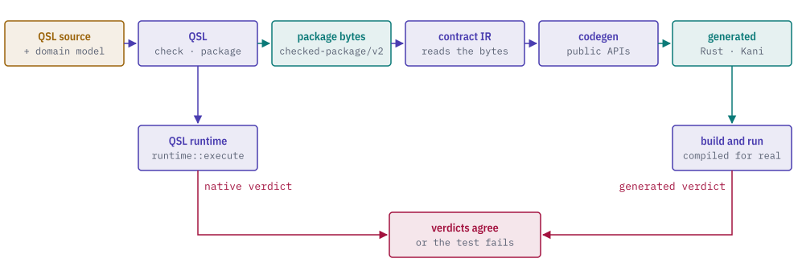
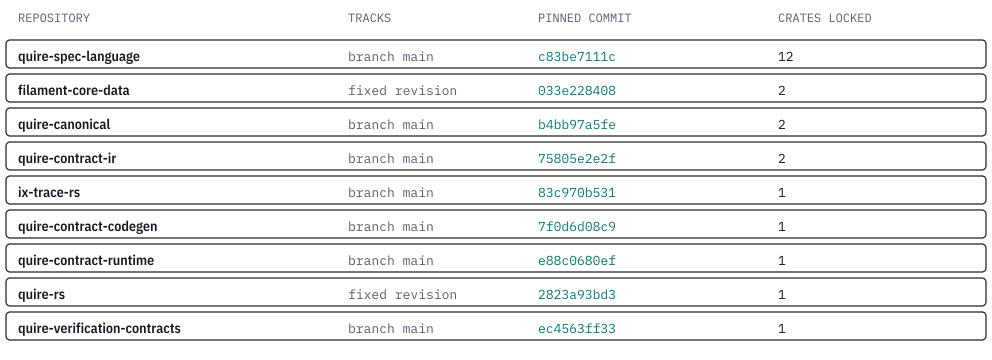

# quire-integration

quire-integration is the cross-repository integration test crate for the Quire
toolchain. It checks that the stages, each in its own repository, agree on the
bytes they pass to each other.

It pins every stage to an exact commit in one `Cargo.lock`. Its tests admit
checked QSL packages through Contract IR, pass supported scalar operations to
the code generator, and exercise real proof and native paths. The table below
states which paths each test composes.

<picture>
  <source media="(prefers-color-scheme: dark)" srcset="docs/images/hero-dark.svg">
  
</picture>

> **Status: prerelease, private repository.** The library crate is a
> unpublished library with a checked subject/classification binding validator
> and a bounded checked-formula to TL owner-formula constructor. Other current
> functionality lives in integration tests. The composed runtime
> described in the repository's early charter (ordered execution bundles,
> effect-adapter coordination, model views) is not implemented.

## Tests

The composition tests use the locked producer and consumer APIs. The table
lists the path each test exercises.
The IR-914 export tests cover the natural relationless skip and a real QSL
`export_bindings` result passed through driver and CG. The original partition
control also injects one refusal to test exact driver transport. The real
export test forces the driver's relation seam because its checked source does
not author an abstraction relation.

| Test file | Path it exercises | What must hold |
| --- | --- | --- |
| `tests/ir914_bound_export.rs` | QSL compilation, the driver's relationless skip and real per-item binding export, CG generation, and a separate real Kani scalar path | The skip sends every item to CG; a real QSL refusal is withheld with its original index; the integer proof verifies and its arithmetic mutant falsifies |
| `tests/qsl_model_owner_admission.rs` | A QSL unit emitted as `checked-package/v2` bytes, read by contract IR and passed to CG's scalar claim API | Model ownership stays content based; integer addition and Boolean negation produce checked CG claims |
| `tests/integration.rs` | The placeholder library | It links |
| `tests/temporal_mapping_binding.rs` | Strict checked-package subject, native QSL evidence request, and independently admitted QObs observation | Exact occurrence and binding authentication; opaque observation identity selects one numeric anchor while retaining original valuation cells |

The temporal formula component accepts an instance-bound QSL checked subject and
classification, preserves occurrence order and original checked predicate handles,
and constructs and strictly admits an actual TL owner formula. Its node, component
visit and byte ceilings are separate from owner-internal limits. It retains every
outstanding classification premise; it establishes no runtime Boolean totality and
runs neither evaluator. Full projection, valuation/history/request admission,
correspondence, result joins, bridge readers and the remaining limits stay Planned.
`tests/temporal_formula.rs` covers this narrow IT-020/TC-101 boundary; none of the
whole FR-350 criteria is claimed complete by this component.

The native temporal input component accepts the actual QSL `EvidenceRequest` and
`TraceBinding`, authenticates the selected clause occurrence and profile/clock,
and retains the original trigger, native valuation relation identity and position
valuations. A present opaque anchor
must match one request position and an independently admitted QObs observation
before its numeric position is exposed. It retains the checked package owner's
selected model package identities in their admitted order without source aliases.
`tests/temporal_mapping_binding.rs` covers
this IT-022 prerequisite and composes it with strict TL formula construction
against one admitted package. It does not construct a TL request or invoke an evaluator.

The observation revision component strictly admits genuine QObs v1 historical bundle
bytes, verifies exact selected observation membership including envelope revision, and
retains the actual current/prior owner values and immutable bytes. It delegates bundle
lineage to QObs and establishes no selected observation-document lineage, QSL capture
binding, native Report binding or native/TL result predecessor pair.
`tests/temporal_observation_revision.rs` covers this partial IT-021/TC-114 boundary.
Full correspondence and join admission remain Planned. Component scan/byte limits
exclude owner-internal work, which uses separately supplied native QObs limits.
The normal QObs main dependency shares the existing canonical main encoder with its
production `serde_json` feature. The unchanged IT-014 one-copy dependency cohort check
passes, resolving the previous dependency adoption blocker.

The plain-language test descriptions are in `spec/integration/`, one file per
scenario, each with its objective, preconditions, procedure and expected result.

### Example

The model-owner test supplies a domain document under `foreign/orders` while
its emitted unit selects `acme/orders`. IR refuses the missing selected import
with `MissingImport`, locating it at the model-root owner's identity. The test
`a_domain_package_supplied_under_another_identity_is_refused` in
`tests/qsl_model_owner_admission.rs` checks the real emitter and reader through
their current typed APIs.

## Version lock

The lock is `Cargo.lock`. `Cargo.toml` names each first-party repository by
branch `main`, and the lock fixes that branch to one commit, so all the crates
of a repository resolve to the same revision. QSL's lowering and the
code generator must share one set of contract IR types. The
table is generated from the lock file.

<picture>
  <source media="(prefers-color-scheme: dark)" srcset="docs/images/lock-dark.svg">
  
</picture>

To move the lock, run `cargo update -p <crate>` for the repository you want and
commit the new `Cargo.lock` together with a passing test run.

## Requirements

The tests fail when a required tool is missing and never dispatch a hosted run.

| Needed by | Tool |
| --- | --- |
| all tests | Rust toolchain selected by `rust-toolchain.toml` |
| `make kani` and `make ci` | Installed Kani and CBMC |

## Quire ecosystem

<picture>
  <source media="(prefers-color-scheme: dark)" srcset="docs/images/ecosystem-dark.svg">
  
</picture>

quire-integration sits at the top of the ecosystem. It depends on the language and backend
repositories (quire-spec-language, quire-contract-ir, quire-contract-codegen,
and through them quire-contract-runtime and the foundation crates) as
development dependencies only. Nothing depends on it, so a disagreement between
stages shows up here. The locked
repositories are listed in the version lock section.

## Building and testing

```bash
make fmt-check   # rustfmt
make lint        # clippy, warnings are errors
make test        # cargo test
make kani        # real Kani proof and mutation
make build       # release build
make deny        # licence check
make audit-unsafe # Clippy unsafe-block documentation gate
make ci          # all of the gates
```

## Contributing and license

Contributions need a signed Contributor License Agreement; see
[CONTRIBUTING.md](CONTRIBUTING.md) and [CLA.md](CLA.md). Original content is
licensed under `AGPL-3.0-or-later`; see [LICENSE](LICENSE) and
[CONTENT_RIGHTS.md](CONTENT_RIGHTS.md).
