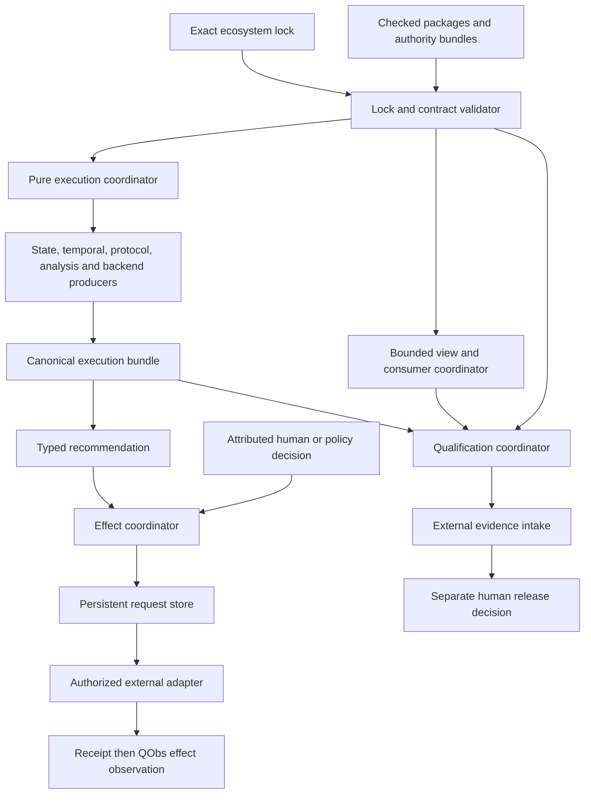

# Composed runtime and qualification boundary

## System Boundary

The library owns coordination across exact versioned interfaces, not the semantics
behind them. Its trusted core validates a complete ecosystem lock and canonical
wire inputs. Pure coordinators invoke selected domain producers, retain their
opaque validated results, and assemble execution, view, impact, and qualification
records. The effect coordinator is the only component with adapter-dispatch
capability. Evidence intake and human decisions remain external authorities.

## Views

The validator exposes constructor-private accepted selections. Coordinators
receive typed capabilities explicitly; there is no global registry or ambient
provider lookup. All emitted collections use canonical semantic ordering.
Independent failures remain item-local unless the accepted shared prerequisite is
contradictory.

## Decisions

| Decision | Alternatives rejected | Observable consequence |
|---|---|---|
| One complete lock precedes all dispatch | Per-producer current defaults | Every run has one reproducible identity and preflight failure invokes nothing. |
| Domain results remain opaque owner values | Common Boolean/result reinterpretation | Unsupported and incomplete siblings remain independently readable. |
| One persistent effect coordinator owns adapter capability | Evaluator callbacks or direct adapter handles | Authorization and idempotency checks dominate every dispatch. |
| Views and consumers operate on validated semantic artifacts | Parse rendered/generated output back as authority | Layout, heuristics, and parser acceptance cannot change meaning. |
| Qualification records evidence; humans decide | Automatic score/release promotion | Missing vectors and explicit limits remain accountable. |

## Risks

| Risk | Control | Owner | Next review |
|---|---|---|---|
| Producer interfaces are not yet mutually compatible | FR-001 strict lock plus typed unsupported outcomes | integration maintainers | before C11 implementation |
| Effect persistence semantics are underspecified by a selected store | FR-003 and IT-002 require persist-before-dispatch crash tests | workflow boundary owner | before C12 implementation |
| Qualification corpus or intake capability is unavailable | FR-006 records unsupported/incomplete without mocks | qualification owner | before C14 execution |
| Graph or view traversal expands without bound | NFR-001 preflight budgets and generated boundary tests | integration maintainers | each implementation review |
