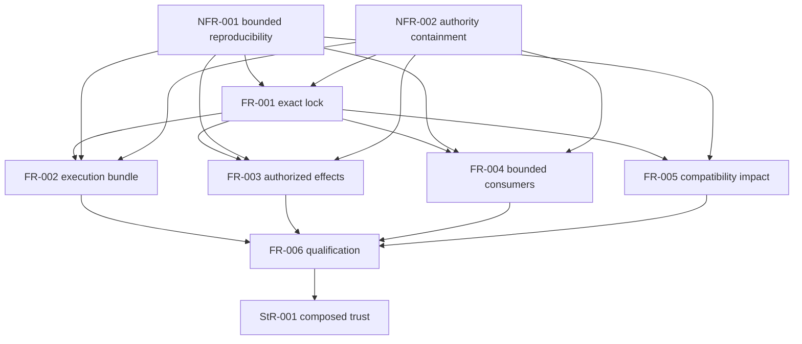

# SR-004: Dependency review of complete V1 integration

## Summary

The requirement DAG is acyclic: cross-cutting constraints and exact lock
validation precede four independent feature tracks, all of which precede
complete qualification. This matches Research #74 → #75/#76/#77 → #78 while
retaining QObs #24 as an external effect/repair prerequisite.

## Findings

| ID | Severity | Summary | Refs |
|---|---|---|---|
| FND-006 | medium | Resolved: qualification lacked explicit dependency edges to authorized effects and bounded consumers; FR-006 now depends on FR-003 and FR-004. | FR-006 |

## Classification

| Requirement | Class | Rationale |
|---|---|---|
| StR-001 | Feature | Defines the stakeholder-visible trustworthy composed outcome. |
| FR-001 | Enablement | Validated exact locks gate every producer and consumer. |
| FR-002 | Feature | Delivers composed independent execution results. |
| FR-003 | Feature | Delivers authorized persistent effect coordination. |
| FR-004 | Feature | Delivers deterministic bounded consumer views/accounting. |
| FR-005 | Feature | Delivers compatibility and stale-evidence impact records. |
| FR-006 | Feature | Delivers complete integration qualification accounting. |
| NFR-001 | Enablement | Establishes deterministic resource budgets for every operation. |
| NFR-002 | Enablement | Establishes authority/capability containment before dispatch. |

## Dependency Graph

## Topological Order

1. Apply NFR-001/NFR-002 constraints and implement FR-001 lock validation.
2. Implement FR-002, FR-003, FR-004 and FR-005 as independent tracks after
   their external producer contracts are pinned.
3. Implement FR-006 after all four tracks and all A/B/D/E lane qualification
   inputs are available.
4. Demonstrate StR-001 through IT-001 through IT-004.

## Cycles

None detected. Runtime dependency graphs may contain cycles as bounded input to
FR-005; that data topology is not a cycle in the requirement DAG.

## Verdict

PASS. The DAG is ready for forward plan decomposition.
