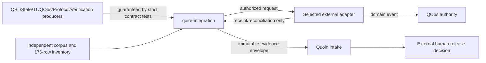

# SR-007: Scope and boundary review of complete V1 integration

## Summary

The repository owns exact selection, coordination, persistence protocol,
consumer accounting, compatibility impact and qualification rollup. Every
semantic producer, business-effect observation and release decision remains
with its external authority.

## Findings

| ID | Severity | Summary | Refs |
|---|---|---|---|
| FND-011 | high | Resolved: the effect boundary did not distinguish an adapter's transport guarantee from QObs business-effect authority during uncertain retries; FR-003 and IT-002 now allocate both responsibilities explicitly. | FR-003; IT-002; AD-001 |

## System Context

## External Dependencies

| Dependency | Type | Assumed or Guaranteed | Contract |
|---|---|---|---|
| Domain producers | versioned Rust/wire capabilities | Guaranteed | FR-001 lock plus IT-001 strict-reader/reference workflows |
| Durable request store | persistence | Guaranteed | IT-002 persist-before-dispatch and restart tests |
| Effect adapter | HTTP/typed transport | Guaranteed within selected manifest | idempotency/reconciliation contract in FR-003 and IT-002 |
| QObs | business-effect authority | Guaranteed | matching authority-qualified observation; receipts never substitute |
| Render/analyze/codegen tools | bounded consumers | Guaranteed | IT-003 real APIs and output readers |
| Quoin evidence intake | evidence service | Guaranteed when available | IT-004 real Rust intake; otherwise explicit unsupported/incomplete |
| Human release authority | external actor | Assumed authenticated and scope-limited | immutable FR-338 decision validated but never created by this library |

## Responsibility Allocation

| Requirement | Owning Component | Class |
|---|---|---|
| StR-001 | complete integration system | core |
| FR-001 | ecosystem-lock validator | core |
| FR-002 | execution-bundle coordinator | core |
| FR-003 | effect coordinator and durable request boundary | infrastructure |
| FR-004 | view/consumer coordinator | core |
| FR-005 | compatibility-impact coordinator | core |
| FR-006 | qualification coordinator | core |
| NFR-001 | every coordinator and strict boundary | cross-cutting |
| NFR-002 | capability constructors and dispatch graph | cross-cutting |

## Out-of-Scope Confirmation

No component parses source, reimplements domain semantics, fabricates evidence,
executes an effect from an evaluator, treats rendering as authority, or makes a
release decision.

## Verdict

PASS. Every requirement and external dependency has one explicit owner.
